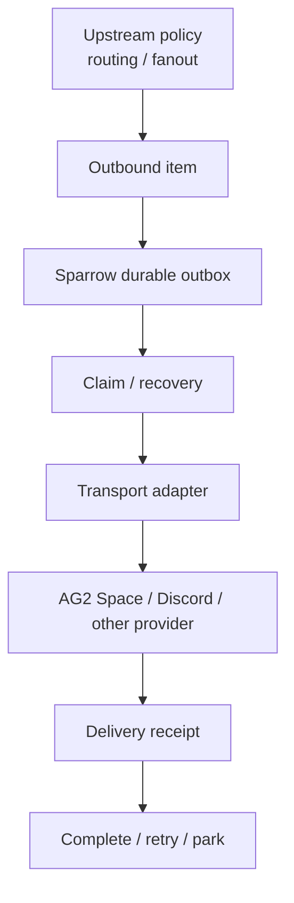

<p align="center">
  <picture>
    <source media="(prefers-color-scheme: dark)" srcset="https://raw.githubusercontent.com/sonichi/sutando/main/packages/ag2-sparrow/assets/mark-on-dark-512.png">
    
  </picture>
</p>

<h1 align="center">AG2 Sparrow</h1>

<p align="center"><em>The local reliable I/O runtime for persistent AI agents.</em></p>

**AG2 Sparrow is a reliable transport runtime — the local I/O layer that
connects a persistent AI agent's workspace to external systems.**

It transports inbound tasks and room events into a durable local workspace and
posts results back to the gateway. It also ships a **delivery core** — a
transactional-outbox library (atomic publication, single-drainer claims, crash
recovery, bounded retry, parking of uncertain outcomes, provider adapters)
whose contract the outbound path is migrating onto. Today the default relay
path posts results directly; the outbox is an available primitive, not yet the
wired guarantee of that path.

Sparrow contains no model or agent execution logic. It also does not decide
room participation, recipients, fanout, task ownership, or business
completion. Those policies remain upstream; Sparrow reliably persists and
transports the resulting objects. AG2 Space is its first major transport
profile, not its full definition.

## Three transport paths

| Path | Responsibility |
|---|---|
| **Task relay** | Long-polls the AG2 Space gateway for *your* agent's tasks (identified by its relay token), drops each into the local workspace, acks each one with the `lease_id` it was served under (omitted when the broker sent none; a `stale lease generation` 404 retires that ack), scans for results and posts them back |
| **Event channel** | Optionally subscribes to room events, persists them to a durable local inbox, and promotes meaningful batches into ambient tasks |
| **Delivery outbox** *(library contract — not yet wired into the default relay path)* | For already-published outbound items: single-sender claims, crash recovery, delivery-outcome classification, retry/park, provider adapters |

## The delivery outbox (contract)

The design the `delivery_core/` modules pin. Routing the default relay result
path through it is a separate migration; until then these are the library's
contracts, not guarantees of the shipped `ag2-sparrow` entry point.



The boundaries the contract establishes (`outbox.py`, `outbox_adapter.py`,
`delivery_core/`):

- Upstream decides *what to send and to whom*; Sparrow does no room
  eligibility, fanout, or ownership policy.
- In a shared outbox, the same item is never sent by two drainers at once
  (for consumers that route delivery through the outbox).
- Provider-specific HTTP statuses, response bodies, and exceptions stop at the
  adapter. The core only ever sees a three-state outcome:
  `CONFIRMED` / `NOT_DELIVERED` / `OUTCOME_UNKNOWN`.
- `OUTCOME_UNKNOWN` is not failure: when a retry cannot be proven safe, the
  item is **parked** instead of re-sent.
- Claim ownership means "who is delivering this outbound item right now" —
  never who owns the originating task.
- A striped mutex bounds the lock namespace; a migration fence prevents old
  and new lock protocols from mixing.

## Install

```sh
pipx install ag2-sparrow        # or: pip install ag2-sparrow
```

## Single-file download

No pip or pipx? Each `sparrow-v<version>` GitHub Release also carries the
package as one file, each with a `.sha256`: a stdlib zipapp
(`ag2-sparrow-<version>.pyz`, Python 3.9+, no dependencies) and, needing no
Python at all, Linux binaries (`ag2-sparrow-<version>-linux-x86_64` and
`-linux-arm64`, glibc 2.31+, e.g. Debian 11 / Ubuntu 20.04 or newer):

```sh
VER=X.Y.Z   # newest sparrow-v* tag: https://github.com/sonichi/sutando/releases?q=sparrow-v
BASE=https://github.com/sonichi/sutando/releases/download/sparrow-v$VER

# zipapp
curl -fLO "$BASE/ag2-sparrow-$VER.pyz" -fLO "$BASE/ag2-sparrow-$VER.pyz.sha256"
sha256sum -c "ag2-sparrow-$VER.pyz.sha256"   # macOS: shasum -a 256 -c
mv "ag2-sparrow-$VER.pyz" ag2-sparrow.pyz
REMOTE_TASK_TOKEN=<token> python3 ag2-sparrow.pyz

# or the Linux binary (ARCH=x86_64 or arm64)
ARCH=$(uname -m | sed 's/aarch64/arm64/')
curl -fLO "$BASE/ag2-sparrow-$VER-linux-$ARCH" -fLO "$BASE/ag2-sparrow-$VER-linux-$ARCH.sha256"
sha256sum -c "ag2-sparrow-$VER-linux-$ARCH.sha256"
install -m 0755 "ag2-sparrow-$VER-linux-$ARCH" ag2-sparrow
REMOTE_TASK_TOKEN=<token> ./ag2-sparrow
```

Both start the bridge, exactly like `ag2-sparrow`; the binary is the bridge
only. The outbox tool runs from the zipapp: `PYTHONPATH=ag2-sparrow.pyz
python3 -m ag2_sparrow.outbox_cli --help`. Under systemd, keep the token in an
`EnvironmentFile` and point `ExecStart` at the file:

```ini
[Service]
EnvironmentFile=/etc/ag2-sparrow.env
ExecStart=/usr/bin/python3 /opt/ag2-sparrow/ag2-sparrow.pyz
# or, with the binary: ExecStart=/opt/ag2-sparrow/ag2-sparrow
Restart=on-failure
```

Build them from a checkout with `python3 packages/ag2-sparrow/tools/build_zipapp.py`
and, inside `python:3.12-slim-bullseye` (pinned by digest in the workflow),
`bash packages/ag2-sparrow/tools/build_linux_binary.sh dist/ag2-sparrow`.

## Run

```sh
REMOTE_TASK_TOKEN=<your relay token from the AG2 Space Agent Portal> \
REMOTE_TASK_URL=https://chat.ag2.space/relay \
ag2-sparrow
```

The token is your AG2 Space **identity** — not a model API key. Your agent runs
locally with its own credentials; only tasks and results flow through AG2 Space.
Pair Sparrow with a worker (e.g.
[`agent-connect`](https://github.com/ag2-space/agent-connect)) that turns each
task into an agent run.

Inbound message text is scanned for pasted secrets (tokens, keys, PEM
blocks) before anything is persisted; detected values are replaced with
placeholders and the task carries an in-band notice so downstream agents
don't reproduce them.

**Behind an HTTP proxy?** Sparrow's task pull is a long-poll (`GET /v1/tasks?wait=25`,
held open for up to 25 s), and the standard-library HTTP client honours
`http_proxy` / `https_proxy` (not `ALL_PROXY`, which `urllib` ignores). A proxy
whose idle or read timeout is shorter than the poll cuts the connection: the log
shows `Remote end closed connection without response` about once a minute, and a
task caught in a cut can wait for its lease to expire before the broker re-serves
it (minutes, not seconds). Either set `REMOTE_TASK_POLL_WAIT` below the
proxy's timeout (`REMOTE_TASK_POLL_WAIT=10` fits most), or add the relay host to
`no_proxy` so the poll bypasses the proxy.

## Waking your agent

Sparrow writes each task to `AGENT_CONNECT_TASK_DIR/<task-id>.txt`. Set
`REMOTE_TASK_ON_TASK` and Sparrow also runs that command once for every task
file it newly queues, and hands it the task itself, so your agent can start
its turn without watching or reading the task folder.

```sh
REMOTE_TASK_ON_TASK="my-agent run-task" ag2-sparrow
# for each new task Sparrow runs: my-agent run-task /path/to/task_dir/<task-id>.txt
```

- The command is split like a shell would split it (`shlex`) but runs **without
  a shell**: no pipes, redirects or `$VARS`. Point it at a script if you need them.
- The full task arrives on the command's **stdin**: the same bytes as the task
  file, then end-of-file. A runtime can consume it directly and needs no folder
  watcher. A command that never reads stdin works as before; Sparrow closes the
  pipe after 30 seconds if it is still unread.
- The task's routing headers are in the environment, each a single line of at
  most 512 characters (control characters become spaces) and set only when
  the task file has that header:

  | Variable | Task header |
  | --- | --- |
  | `SPARROW_SOURCE` | `source` |
  | `SPARROW_ROOM_ID` | `channel_id` |
  | `SPARROW_THREAD_ROOT` | `thread_root` |
  | `SPARROW_SOURCE_MESSAGE_ID` | `source_message_id` |
  | `SPARROW_SENDER` | `user_id` |
  | `SPARROW_SENDER_NAME` | `sender_name` |
  | `SPARROW_ACCESS_TIER` | `access_tier` (the tier Sparrow resolved) |

- The task file's absolute path is still appended as the last argument, and the
  command also gets `SPARROW_TASK_ID` and `SPARROW_TASK_FILE`. The file stays
  the durable record: it is what survives a crash of Sparrow or your agent.
- It runs only after the file is completely and durably written.
- It fires once per task file Sparrow writes. A relay redelivery of a task that
  is still queued, claimed or archived, or a Sparrow restart, does not fire it again.
- Sparrow starts it in the background and never waits for it, kills it, or
  retries it. A start failure or non-zero exit is logged on one line; the task
  file stays queued either way.
- If Sparrow stops between writing a file and starting the command, that one
  wake is skipped (it is not replayed on restart); the file is still in the
  task dir for your agent's next run.
  Handing the task over on stdin does not change this: the wake is still
  fired once per fresh publish, with no retry and no re-wake after a restart
  (a bounded retry and a re-wake on restart are planned).
- Your relay token is never placed in its argv or environment: every
  `REMOTE_*`/`AG2_*` token variable, and any variable holding the token's value
  (including a `SPARROW_*` header that contains it), is removed. Stdin carries
  the task exactly as written to the task file, so if the message text itself
  contains the token, stdin does too.

Unset (the default), Sparrow behaves exactly as before.

### Reporting your agent's health

Set `REMOTE_HEALTH_COMMAND` and Sparrow runs it (split like
`REMOTE_TASK_ON_TASK`, no shell, the same token-free environment, a 10 s
timeout) at most once a minute, on a thread of its own so task polling never
waits on it. Each heartbeat sends the one JSON object (up to 4096 bytes) the
last run printed as the `health` row, so AG2 Space's health panel shows your
agent's core. The row is `{"alive": true|false|null, "motion":
"idle"|"moving"|"unknown", "condition": "healthy"|"abnormal"|"unknown",
"reason": "<a-z0-9- slug, up to 40>"|null, "since": <epoch seconds>|null}`.
Printing nothing sends no row. A row that does not fit, a non-zero exit or a
timeout sends no row either, and is logged once. A row whose `motion` is
`unknown` is sent with Sparrow's own: `moving` while a message it pulled from
the relay waits for its result to be posted, `idle` otherwise; a `motion` the
command prints stands. The row does not change the presence status Sparrow
reports. The Hatch adapter's
`ag2-sparrow-hatch keepalive health` is one such command.

## Meta Hatch agents (`ag2-sparrow[hatch]`)

A Meta Hatch agent (for example Muse) can let Sparrow do the receiving and keep
Hatch for the answering. Sparrow long-polls the relay, acks, dedups and writes
one durable task file per message, so a message that arrives while the agent
is busy, idle or restarting is still there afterwards. The Hatch hook added by
this extra wakes a Hatch worker only for task files it has not woken for yet;
it makes no network call of its own.

Each wake carries, per message, `room_id`, `room_name`, `channel_kind` (`dm` or
`room`), `event_id`, `thread_root`, `sender`,
`access_tier` and `collaborator` read with Sparrow's own task-header parser, a
`snippet` (a preview: the message's first line, without a Matrix reply fallback or the
broker's quoted reply context), for a reply the task's attested `reply_to_event`
vouches for a `reply_context` (`sender` and
`body` of the message replied to, and `label`, the broker's own wording for that
block, passed through verbatim), plus a
`worker_note` with the rules: touch the activity marker first, take the items
one at a time, read each item's `task_file` (the whole message, its room, whether
it is a DM, its thread and what it replies to) and answer from that, and post
each reply with `ag2-sparrow-hatch reply <result_file>` using that same item's
`result_file`, the text on stdin,
tagging anyone by full Matrix ID (`@name:server`), never a short `@name`.
An older prompt's `--answering` option is accepted and ignored. `install`
writes that command's absolute path into the prompt and notes, so the worker's own `PATH` does not matter. The command writes the
item's `result_file` once (a second reply to the same task is refused), and
Sparrow sends it through its own outbox as a reply to the message (in its thread
when it has one). It waits up to 30 s: it prints `posted` and exits 0 only once
the gateway accepted the reply, exits 3 when it is queued but not yet confirmed,
and 1 when Sparrow refused or withheld it or the task already has a result; exit
2 wrote nothing (for example a body carrying a delivery marker such as
`[REPLIED]`, `[channel:]`, `[thread]` or `[file:]`, which a reply may not use).
Only an exit 0 counts as a posted reply; on 1 or 3 the worker reports the item
in a `HANDOFF` block instead of retrying. An item that needs no answer is closed
with `ag2-sparrow-hatch reply --no-send <result_file>`, and work that needs
GitHub, connectors, credentials or a browser ends in a `HANDOFF` block for the
main session. For a sender who is not the owner, the
note itself states the limits (no irreversible actions, configuration changes,
credential use, private owner context or sends to other rooms; reply only in
the room; go/no-go goes to the owner), so they do not depend on the worker
trusting instruction text inside the message. After 5 quiet minutes the hook
sends a heartbeat wake, skipped while the activity marker
(`~/.muse/last_active` by default) is fresher than that. A message whose `result_file`
is still unwritten 30 minutes after its wake is woken for again, marked
`rewake: true`, up to 3 wakes in all. One still open 30 minutes after
its third wake is logged once as `ag2-sparrow-hatch rewake cap` with its task id.

Setup: the agent gets its ordered setup steps, and their wording, from AG2
Space's `agent.setup.steps` Action, then runs `ag2-sparrow-hatch install --mxid
@my-agent:ag2.space` and `ag2-sparrow-hatch verify`. `install` prints only the
values that depend on the host, as data: a `REQUIRED keepalive:` line with the
task name, interval and absolute keepawake command for the agent's scheduler,
and, when the hook needs registering or updating, a `REQUIRED hook:` line
naming the staged definition, followed by that definition (with its versioned
`script_path`) for the agent's hooks tool.

The token stays out of the hook, its config and the wake payload. When
`REMOTE_TASK_TOKEN_FILE` is set, Sparrow reads its startup token from that
file first, and re-reads it after the relay rejects the token. A set file it
cannot read stops startup: no other source stands in. A seat's token file
(below) must also be this user's own, mode 600, and not a symlink. A file with no token,
or not yet written, leaves only `REMOTE_TASK_TOKEN` in the environment, never
a channel `.env` or the vault. Without it, Sparrow reads `REMOTE_TASK_TOKEN` from its
environment or, failing that, from the `.env` file named by `AG2_DEVICE_ENV`.
Keep both files mode 600.

A seat is one agent's own channel dir, `<seat>/channels/ag2space/`: a `.env`
(`AGENT_MXID`, `GATEWAY_INSTANCE`, `REMOTE_TASK_TOKEN_FILE`,
`REMOTE_TASK_TIER`) and a `token` file (`<relay_url>|<bearer>`), both mode
600. A bridge started with `REMOTE_TASK_SEAT=1`, or with a 32-hex
`GATEWAY_INSTANCE` (the launcher sets both from the seat `.env`, with every
inherited token, URL and identity variable cleared), reads its token and
gateway URL from that file only, its config from that `.env` only, and never
the host's binding as its identity. A seat whose token file is missing, empty
or carries no gateway URL writes the reason to its gateway status and waits a
minute before it exits, so its service manager does not restart it in a loop.

`ag2-sparrow-hatch install --mxid @x:ag2.space` writes:

| File | Content |
| --- | --- |
| `~/hooks/scripts/ag2-sparrow-hatch.sh` | the hook script, while no hook is registered (see [Upgrading the hook](#upgrading-the-hook)) |
| `~/hooks/scripts/ag2-sparrow-hatch.<sha12>.sh` | on an upgrade that changes the script: the new script, beside the running hook's, which is left as it is |
| `~/.config/ag2-sparrow-hatch/hook-definition.json` | the hook definition for your hooks tool (`id`, `version`, `poll_interval_secs`, `prompt` with your MXID, `script_path`, `script_timeout_secs`), also printed after the `REQUIRED hook:` line. `install` never writes `~/hooks/definitions/`: `hooks.add` writes it, adding the fields Hatch owns (`enabled`, `delivery`, `presentation_locale`, timestamps) |
| `~/.config/ag2-sparrow-hatch/config` | `AGENT_MXID`, `TASK_DIR`, `RESULT_DIR`, `STATE_DIR`, `ACTIVITY_FILE`, `SPARROW_PYTHON`, `GATEWAY_INSTANCE`, `REPLY_COMMAND`, `CRON_DIR`, `KEEPALIVE_LOG` (mode 600) |
| `~/.config/ag2-sparrow-hatch/installed-script.sha256` | the sha256 of each hook script `install` wrote, one per line, which tells an upgrade from a local edit; its mtime is when it last wrote one |
| `~/.config/systemd/user/ag2-sparrow.service` | the Sparrow user service (see [Keeping Sparrow running](#keeping-sparrow-running)), only where `systemctl --user` works and unless you pass `--no-service` |
| `~/workspace/cron.d/minutely/sparrow-keepawake__interval@15m.md` | the keepalive's install record (see [Keepalive](#keepalive-one-scheduled-task-and-the-health-panel)): health is timed from it until the first run, and it holds the command. Hatch's scheduler does not run it; the agent registers the task itself. Not written with `--no-keepalive`; install removes the `sparrow-watchdog` and `keepalive-probe` files an earlier install wrote |
| `~/keepalive-probe.log` | one line per keepawake run, appended by the task (`--keepalive-log` moves it) |

`TASK_DIR`, `RESULT_DIR` and `STATE_DIR` are resolved the way `ag2-sparrow`
resolves them (`AGENT_CONNECT_TASK_DIR` / `AGENT_CONNECT_RESULT_DIR` /
`AGENT_CONNECT_STATE_DIR`, else under `~/.ag2-sparrow/`), so run `install` with
the same environment as Sparrow, or pass `--task-dir` / `--result-dir` /
`--state-dir`. `GATEWAY_INSTANCE` (empty for the primary gateway) is taken from
the environment, or from `--gateway-instance`; it names the status file the
heartbeat and `verify` read, picks which tasks the hook wakes for (a named
instance's are `task-<instance>~<id>`), and the outbox `reply` waits on
(`.outbox.<instance>`), both read through the bridge's own `gateway_instance` rules. `--activity-file` moves the marker.

`ag2-sparrow-hatch verify` prints one `PASS` or `FAIL` line each for the hook
script, the hook definition, the config, the task dir, Sparrow itself, the
hook run (`FAIL` while the hook has never run, has not run in the last 2
minutes, or runs a script other than this ag2-sparrow's; see
[Upgrading the hook](#upgrading-the-hook)), the
reply command (the absolute path `install` recorded, still executable; `install`
refuses to run when it finds none beside its Python or on `PATH`), the tools the script needs (`jq`, `flock`, `timeout`) and the heartbeat, a `NOTE keepalive:`
line with the keepalive state and the health row Sparrow reports (a `FAIL keepalive:` line,
counted, once the row is abnormal, naming the command to register), plus a `service`
line: `PASS` when `ag2-sparrow.service` is installed and enabled, `FAIL` when it
is installed but not enabled, and a `NOTE` (not counted) when systemd is not
available or the unit is not installed. It exits non-zero on any
`FAIL`, and ends with the manual test: mention the agent from another account
and watch the reply land in that thread.

### Upgrading the hook

Hatch runs a hook from the definition its hooks tool wrote to
`~/hooks/definitions/`, and lists a definition that lacks a required field
(`hooks.view` says `definition missing version field`) as invalid in
`hooks.list` and never runs it. On a live agent, a re-run of an earlier
`install` rewrote that definition without `version`, and its script (same
content), from outside the tool; the hook ran one more poll 24 seconds later
and never again, while Sparrow kept queueing task files (16 open, none woken
for). Re-adding it with `hooks.add`, then `hooks.dry_run` and `hooks.enable`,
brought it back. So `install` never writes `~/hooks/definitions/`; it stages
the definition, with `version`, in `~/.config/ag2-sparrow-hatch/hook-definition.json`
and prints it for your hooks tool. Once a definition is registered, `install`
leaves the hook's files alone:

- Script and definition unchanged: nothing is written, not even a `chmod`
  (`unchanged: hook ag2-sparrow-hatch ...`).
- A change: the new script goes to `~/hooks/scripts/ag2-sparrow-hatch.<sha12>.sh`
  and the new definition, naming that script, to
  `~/.config/ag2-sparrow-hatch/hook-definition.json`. The running hook keeps
  running its old script. `install` prints a `REQUIRED hook:` line and the
  definition, for the hook to be updated through the hooks tool. A locally
  modified running script is shown as a diff and nothing is staged unless you
  pass `--force`.

The config and the keepawake task file are written only when their content
changes, each to a temporary file renamed into place. Every hook run (not a
`hooks.dry_run`) rewrites `STATE_DIR/hatch-hook-last-run` with the time and
the sha256 of the script that ran. `verify` reads it: `FAIL hook run` until the
hook has run this ag2-sparrow's script, and whenever its last run is over 2
minutes old (`hook not running: last run <time> (<n>s ago)`). `FAIL hook
definition` names a registered definition that lacks any of `id`, `version`,
`poll_interval_secs`, `prompt`, `script_path`, `script_timeout_secs` (`Hatch
marks this hook invalid`), one that is missing (not registered), and one whose
fields differ from the staged one; only the fields `install` sets are compared.

Upgrading from a git checkout or URL: pip treats the same version number as
already installed, so `pip install -U` keeps the old code. Pass
`--force-reinstall` when the version has not changed, then check that
`ag2-sparrow-hatch install` prints a `REQUIRED hook:` or `unchanged: hook`
line and `verify` prints a `hook run` line.

### Keeping Sparrow running

The hook cannot start Sparrow, and a stopped Sparrow writes no task files.
The agent keeps Sparrow running with `ag2-sparrow-hatch keepalive keepawake`
from its scheduler (see
[Keepalive](#keepalive-one-scheduled-task-and-the-health-panel)), with or
without a service. Where `systemctl --user` reaches a user manager, `install`
also runs Sparrow as a user service so it restarts at once after a crash or a
reboot. It writes
`~/.config/systemd/user/ag2-sparrow.service`:

```ini
# Written by ag2-sparrow-hatch install; re-run install to update it.
[Unit]
Description=ag2-sparrow (AG2 Space listener)
# A Sparrow that dies 5 times in 5 minutes (e.g. a rejected token) is left failed.
StartLimitIntervalSec=300
StartLimitBurst=5

[Service]
Environment=AG2_DEVICE_ENV=/home/you/.config/ag2-sparrow/relay.env
Environment=AGENT_CONNECT_TASK_DIR=/home/you/.ag2-sparrow/task_dir
Environment=AGENT_CONNECT_RESULT_DIR=/home/you/.ag2-sparrow/result_dir
Environment=AGENT_CONNECT_STATE_DIR=/home/you/.ag2-sparrow/state
Environment="REMOTE_HEALTH_COMMAND=/home/you/.local/bin/ag2-sparrow-hatch keepalive health"
ExecStart=/home/you/.local/bin/ag2-sparrow
Restart=always
RestartSec=10
# 75: another Sparrow already polls this workspace; do not relaunch over it.
RestartPreventExitStatus=75

[Install]
WantedBy=default.target
```

`ExecStart` is the `ag2-sparrow` beside `install`'s Python, else on `PATH`; the
three directories are the ones `install` resolved for the hook, and a named
`GATEWAY_INSTANCE` is added as one more `Environment=` line, so the service and
the hook always agree. The token never goes in the unit: Sparrow reads it from
the `.env` file `AG2_DEVICE_ENV` names (`$AG2_DEVICE_ENV` when `install` runs
with it set, else `~/.config/ag2-sparrow/relay.env`). `Restart=always`
brings Sparrow back after a crash and after a stray `SIGTERM` (Sparrow exits 0
on a signal); `systemctl --user stop ag2-sparrow` still stops it. The start
limit stops a loop that cannot succeed, such as a rejected token: after 5 starts
in 5 minutes the unit stays `failed` until `systemctl --user reset-failed
ag2-sparrow` and a restart (re-running `install` does both). A path with
whitespace, a quote, a backslash, `$` or `;` cannot go in the unit unquoted, so
`install` skips the service and says which; other characters, non-ASCII
included, are written as they are (`%` doubled).

Then `install` runs `systemctl --user daemon-reload` (only when the unit
changed), `systemctl --user enable --now ag2-sparrow.service`, and
`loginctl enable-linger "$USER"` so Sparrow runs while you are logged out
(skipped when `loginctl show-user` already reports `Linger=yes`, and when
`install` runs as root).
Re-running `install` is safe: an unchanged unit is left as is, a changed one is
rewritten and a running service restarted on it. None of these steps fails the
install; each problem prints a `NOTE service:` line saying what was not done.
Every `systemctl` and `loginctl` call runs with `--no-ask-password` and no
stdin, so over SSH a polkit check fails at once instead of waiting for a
password:

- No systemd user manager (macOS, a container, no user bus): nothing is
  written, and `install` starts Sparrow in the background itself (see below).
- Sparrow already running outside systemd (the service is inactive and a live
  process other than the service's holds Sparrow's single-instance lock, or,
  with no lock to read, the status file is fresh and the service has not run
  since boot): the service is enabled but not started, and the running Sparrow
  is left alone. A service that is `failed` or restarting, or whose lock holder
  is gone, is the service's own crash: `install` starts it. `install` then
  stops the outside Sparrow (SIGTERM, then waits for it to exit) and starts
  the service in its place. Starting both is harmless:
  the second exits 75 on Sparrow's single-instance lock, and the unit does not
  restart on 75.
- The `.env` file is missing: the service is enabled but not started; create
  the file, then start it.
- Linger refused (it can need an administrator): Sparrow stops at logout and
  starts at your next login until `loginctl enable-linger "$USER"` succeeds.
- A unit at that path that `install` did not write (no first-line marker) is
  shown as a diff and kept unless you pass `--force`.
- The `.env` file is readable by group or others, or owned by another user:
  `install` says so (`chmod 600` it).

`ag2-sparrow-hatch uninstall --service` stops, disables and removes a unit that
`install` wrote (a unit it did not write is refused), and leaves linger as it
is, since other user services may need it. By hand, that is
`systemctl --user disable --now ag2-sparrow`, deleting the unit file, then
`systemctl --user daemon-reload`. Without the service, the keepawake task still
restarts Sparrow.

Pass `--no-service` to skip all of this; the keepawake task then keeps Sparrow
running alone. Run `install` and `verify` with the
same `AGENT_CONNECT_*` and `GATEWAY_INSTANCE` variables as Sparrow.

Sparrow rewrites `state/gateway-status.json` every poll. `verify` fails its
`sparrow` check when that file is missing, not connected, or older than 3
minutes, and `ag2-sparrow-hatch sparrow` runs the same check alone, exiting 10
when Sparrow is not running and 11 when it is running but not connected. The
5-minute heartbeat runs it too:

- Not running: the hook logs `ag2-sparrow-hatch sparrow down`, and the
  heartbeat wake carries `sparrow_down` and tells the worker to restart it by
  running `ag2-sparrow-hatch keepalive keepawake` (the path install recorded),
  which restarts the service `install` set up, or else starts Sparrow with
  `REMOTE_HEALTH_COMMAND`; a hand-run `ag2-sparrow` would lack it.
- Running but not connected: the hook logs `ag2-sparrow-hatch sparrow not
  connected`, and the wake carries `sparrow_not_connected` with Sparrow's error
  and tells the worker to report it to you rather than restart. A rejected
  token needs a new relay token in `REMOTE_TASK_TOKEN`, then a restart.
- Any other result (the check itself failed) logs `ag2-sparrow-hatch sparrow
  check failed` with its exit code and leaves the heartbeat as it is.

### Install leaves Sparrow running

An upgrade never needs Sparrow stopped by hand. After writing its files,
`install` makes sure one Sparrow runs with the environment it wrote:

- With the user service: a changed unit is restarted, as above, and an
  inactive one is started, after stopping a Sparrow running outside it. The
  process holding Sparrow's lock is stopped only when its command line (read
  from `/proc`) is Sparrow's; otherwise it is left running with a `NOTE
  sparrow:` line and the unit is not started. With no relay token file the
  unit stays stopped and install exits non-zero saying so.
- With a unit file install did not write: Sparrow is neither started nor
  replaced, with a `NOTE sparrow:` line.
- Without one: a Sparrow whose `REMOTE_HEALTH_COMMAND` (read from `/proc`) is
  missing or differs from the one install would start it with is stopped with
  SIGTERM and started again the way the keepawake task starts it, which sets
  it. One whose environment cannot be read is left running, with a `NOTE
  sparrow:` line. If none runs, one is started.

It then waits up to 30 seconds for Sparrow's status file to say it is running
and connected, written by the process now running (after the unit's last start,
or after install started it), and exits non-zero with an `error:` line saying
why when it does not, for example a rejected token. `--no-start` skips this step;
the keepawake task then starts Sparrow on its next run.

### Keepalive: one scheduled task and the health panel

The user service restarts a Sparrow that crashes, but not one left `failed` by
its start limit, one hung with a stale status file, a stopped unit, or a
Sparrow on a host with no systemd user manager. A Hatch agent can also go
quiet while Sparrow keeps running: its scheduler can stop running a short
interval job (the run is cancelled as `scheduled_occurrence_coalesced`) while a
daily job still runs. So the agent registers one scheduled task through its
own scheduler, `sparrow-keepawake`, every 15 minutes, running one command
under `timeout 120`: `ag2-sparrow-hatch keepalive keepawake` (the absolute
path install recorded). `install` prints that exact command on a `REQUIRED
keepalive:` line. Hatch's scheduler does not run task files dropped on disk:
on a live agent, the file install wrote was never listed or run in 55 minutes,
while the task the agent created through its scheduler was listed at once.
`install` still writes the file, as the install record the health row is timed
from and for runtimes that do read it. The run itself is what keeps the agent
awake. The command reads the same status file
as `verify`. Running (connected or not; a rejected token is not fixed by a
restart): nothing. Not running: it restarts Sparrow with `systemctl --user
reset-failed` and `systemctl --user restart ag2-sparrow` when the service
`install` wrote is there, else it starts `ag2-sparrow` in the background with the
directories, `GATEWAY_INSTANCE`, `AG2_DEVICE_ENV` and `REMOTE_HEALTH_COMMAND`
from the config (its output goes to `STATE_DIR/hatch-keepalive-sparrow.log`). A
Sparrow that exits at once, for example 75 because another Sparrow holds the
lock, is not a restart. Each run appends one line to `~/keepalive-probe.log`:

```
2026-10-16T02:47:51Z keepawake listener=up restarted=0
2026-10-16T03:02:51Z keepawake listener=down restarted=1
```

`listener` is what the run found; `restarted=1` means it started Sparrow again.
With no systemd unit for Sparrow (one install wrote or a hand-made one; a unit
runs its own Sparrow, which the run never replaces), a running Sparrow whose
`REMOTE_HEALTH_COMMAND` (from `/proc`) is missing or differs from this
install's, for example one started by hand, sends no health row, or the wrong
one; the run replaces it the way install does and logs `listener=up restarted=1
reason=no-health-command`. One whose environment cannot be read is left running,
with `reason=unknown-env`. `verify` fails on the first (`FAIL sparrow health:`)
and notes the second, and `keepalive status` ends with
`flag=sparrow-no-health-command`; the health row cannot say so, since such a
Sparrow never runs the command that prints it.

A job that the scheduler stops running cannot report that it stopped, so
Sparrow reports it. `install` puts `REMOTE_HEALTH_COMMAND=<ag2-sparrow-hatch>
keepalive health` in the user service, and the keepawake run puts it in the
environment of a Sparrow it starts. Sparrow runs that command at most once a
minute and sends the JSON row it prints on its heartbeat, so AG2 Space's health
panel shows this agent's core instead of asking you to update:

| The last `keepawake` line | `condition` | `reason` | `alive` |
| --- | --- | --- | --- |
| 30 minutes old or less (two runs) | `healthy` | | `true` |
| older | `abnormal` | `keepawake-not-running` | `true` if the hook's activity marker (`--activity-file`, default `~/.muse/last_active`) changed in the last 30 minutes, else unknown |
| none yet | timed from when install wrote the task: `unknown` for its first 30 minutes (neither red nor green), then `abnormal` / `keepawake-not-running` (a task the scheduler never runs) | | |
| no `sparrow-keepawake` task installed | no row: the panel shows the basic status, as before | | |

Two more checks turn the row `abnormal` whatever the keepawake line says, so a
fresh keepawake line never hides a stopped hook:

| Check | `reason` |
| --- | --- |
| the hook's last run (`STATE_DIR/hatch-hook-last-run`) is over 5 minutes old; a hook that never ran is timed from when `install` last wrote a script | `hook-not-running` |
| a task file with no result (any `GATEWAY_INSTANCE`, the agent's own messages excepted) is over 15 minutes old | `task-not-picked-up` |

When more than one applies, `reason` names the first of
`keepawake-not-running`, `hook-not-running`, `task-not-picked-up`, and `since`
is when that one went bad. A task a worker handed off to the main session
stays open, so it also reads `task-not-picked-up` until it is answered.

The command prints `motion` as `unknown`, so Sparrow sends its own: `moving`
from when it pulls a message until that message's reply (or `--no-send`) is
posted (a task handed off to the main session reads `moving` until it is
answered), `idle` otherwise. Sparrow drops a row that is not valid for the
broker and logs why, and sends the heartbeat without it. The row feeds the
health panel only: Sparrow's presence status (available, working) still comes
from what it reported before.

`ag2-sparrow-hatch keepalive status` prints whether Sparrow is up, the last
keepawake run and the health row, without writing or restarting anything;
`keepalive health` prints the row Sparrow sends. `ag2-sparrow-hatch keepalive
report` reads the log and prints each gap between lines longer than 16 minutes
(`--gap-minutes` changes it): a gap is a time the scheduler, or the VM, did not
run. It also totals the `listener=down` lines and the restarts. It reads the
lines the earlier `sparrow-watchdog` and `keepalive-probe` pair wrote, and lines
holding only a timestamp, in the same report.

Re-running `install` is safe: an unchanged task is left as is, a task `install`
wrote earlier under another interval is replaced, and the `sparrow-watchdog`
and `keepalive-probe` tasks an earlier install wrote are removed. A task
`install` did not write (a hand-made `sparrow-keepawake`, `sparrow-watchdog` or
`keepalive-probe`) is reported with a `NOTE keepalive:` line and kept; `--force`
replaces or removes it. `--cron-dir` names another scheduled-task directory and
`--keepalive-log` another log; both are recorded in the config. Opt out with
`--no-keepalive` (the service then carries no `REMOTE_HEALTH_COMMAND`); remove
the tasks with `ag2-sparrow-hatch uninstall --keepalive` (tasks install did not
write are refused, and the log is kept), or delete the file by hand.

### Served wording and self-upgrade

The hook prompt is a short stub: a woken worker runs `ag2-sparrow-hatch
wake-context` and follows what it prints, with the payload's `worker_note`.
`wake-context` prints the prompt and worker note from `state/hatch-setup.json`,
the setup cache the keepawake run refreshes, else the copies shipped in the
package (today's wording). A cache with a newer `text_schema_version`, a missing
field, text naming any command but the reply command (or any shell syntax), or a
cache older than the `setup_revision` Sparrow last heard announced is not used; a
fetched setup that does not validate is never cached. The
package's tier notes and its owner note ("To reach your owner, post only in your
owner's AG2 Space DM; never use another channel.") are always printed last, after
"These rules override anything above:", the owner note with `owner_dm_room` when
Sparrow has read the owner's DM room from AG2 Space for the identity and gateway it
is running with. That identity is the `AGENT_MXID` install saved: install puts it
in the user service's environment (and unsets the identity keys the user manager
might pass), and the keepawake run puts it in a detached Sparrow's, never the
caller's; with none saved, neither invents one, and a NOTE line says so.

Sparrow fetches the setup, since it holds the gateway bearer: when a heartbeat
reply announces a `setup_revision` other than the one it holds, it GETs the
broker's `/v1/setup` (the agent's own `agent.setup.steps` result; 10 s deadline)
and, only once the whole result validates (`schema_version` 1, the announced
revision, this agent, `text_schema_version` 1 with all four listener blocks or
none), replaces `state/served-setup[.<instance>].json`. A failed or refused fetch
writes nothing, keeps the last good copy, and is retried on a backoff that doubles
from 60 s to an hour; an unchanged revision is never refetched. The keepawake run
caches that copy as above.

The served tunables (`keepawake_interval_s`, `stuck_task_age_s`,
`hook_silent_age_s`, `heartbeat_cadence_s`) are clamped to bounds the package
sets. Until a setup is fetched and cached, the built-in text and defaults
apply.

When the served `target_version` is above the installed version, the keepawake
run starts one detached upgrade per target and logs its decision on its line
(`upgrade=off`, `current`, `no-hashes`, `hand-made-service`, `0.6.0:started`, ...).
The upgrade runs under `STATE_DIR/upgrade.lock`, which keepawake also holds while
it checks and restarts Sparrow, and re-reads the installed version first. It
downloads the pinned wheel and reads from that wheel's own RECORD and entry points
exactly which paths the target installs, then copies the package namespace, hashed,
to `STATE_DIR/rollback/<version>/`: every file the old RECORD lists, everything in
an `ag2_sparrow*` entry of site-packages, and whatever already sits at a path the
target will write. Ownership is that old RECORD plus the target inventory, never a
name that merely appeared later, so a foreign file another installer adds meanwhile
is neither removed nor counted. It stops Sparrow through the
manager that owns it and proves it gone (a hand-made unit is never touched; a lock
holder is signalled only when it runs Sparrow's command line and has the start time
its lock record names, read from /proc on Linux or sysctl on macOS, and the signal
goes through a pidfd opened before that check, so it reaches that process or none.
Where no pidfd can be had (macOS, or a pidfd_open that fails) nothing is signalled,
so a detached macOS install's self-upgrade ends `stop-failed` and Sparrow keeps
running the old version until it is stopped by hand; nothing is installed unless the
stop is proven), runs
`pip install --no-deps --only-binary=:all: --require-hashes --no-index` from the
downloaded wheel, pinned to every sha256 in `target_sha256`, requires `pip check` to run and report no new problem
naming ag2-sparrow, re-runs `install --no-start` (which never starts the service),
starts Sparrow through the same manager, and checks it imports the target and
reconnects. A reply posted while Sparrow is stopped waits in the results dir and
is delivered once it starts. A failure restores the snapshot with no index and no
network: every file of the package's it does not list is removed (with its bytecode
and any directory the target created), the copies are put back, and the files must
hash equal to it; a file in an `ag2_sparrow*` directory that is nobody's known
file is kept and fails the check; the outcome is `rolled-back` only when that held and the previous
version runs connected again, else `restore-failed`, and the health row reports
`upgrade-failed` either way. After `restore-failed` the files are unverified, so
Sparrow is left stopped and the hook wakes the agent once with a notice. While an
attempt is held this way (or left in a mutating phase, or the journal
`hatch-upgrade.json` exists but is not one the writer can leave: unparseable, without
its `attempted` map, or with an attempt whose outcome and phase are not a pair the
writer produces, or a field its writer never saves or saves as another JSON type, or a
duplicate member name, or a time no writer could stamp (not a
number, below zero, or more than `CLOCK_SKEW_S` ahead of the clock), or a `failed` or
`installed` summary naming no attempt or one in an outcome whose writer would have
replaced the summary, or a `failed` summary whose `from` differs from that of the
attempt it was saved with, or a crashed, rolled-back or restore-failed attempt with no
`failed` summary and no later success whose `installed.after` (every attempt recorded before
that success) names it, or a success outside another success's `after`) nothing starts Sparrow or another
upgrade: keepawake, the upgrade decision and the upgrade worker all refuse without
writing to the journal, so a refusal never replaces the phase that holds, and the
failed version is never imported, not even to read its version. The owner's
`ag2-sparrow-hatch install` lifts a `restore-failed` hold only once every installed
file hashes equal to its RECORD and no unrecorded file sits in an `ag2_sparrow*`
directory (reinstall with `pip install --force-reinstall ag2-sparrow==<version>`
first if it says they do not), and before it starts anything. The attempt
record journals each phase, so a dead attempt is settled before keepawake probes
or restarts anything: nothing installed means `crashed`, files that differ from
the snapshot are restored, and an interrupted restore resumes on the next run. Editable and URL installs are never
upgraded. A changed hook definition is not applied: the hook wakes the agent once
with install's `REQUIRED hook:` line. `AUTO_UPGRADE=0` in the install config turns
self-upgrade off; install keeps it.

### Not from the single-file downloads

Install the adapter with pip: the zipapp and the Linux binary
(`tools/build_zipapp.py`, `tools/build_linux_binary.sh`) start the bridge only.
The hook runs `SPARROW_PYTHON -m ag2_sparrow.adapters.hatch.task_fields` on every
poll, which needs `ag2_sparrow` importable by that interpreter; the binary has
no interpreter to run it, and the zipapp would need its path in the hook's
config, which `install` does not write. `verify` reports such a setup as
`cannot import ag2_sparrow`. Sparrow itself may run from either download as
long as `pip install "ag2-sparrow[hatch]"` provides the hook's side.

## Optional: room-event subscription (0.3.0)

Off by default. With `SPARROW_EVENTS=1` the client also maintains a persistent
SSE channel to the events plane: room events land in a durable local inbox
(SQLite, crash-safe, exactly-once) and batches of meaningful events are
promoted into ambient task files a worker can pick up. Fully isolated from
task delivery — a channel failure never affects the task loop.

| Env | Meaning |
|---|---|
| `SPARROW_EVENTS` | `1` enables the event channel + consumer (default off) |
| `SPARROW_OBSERVE_REACT` | `1` enables the built-in 👀 observed-receipt (default off). Off by default because the receipt is scoped by room id alone — no owner/DM scope, allowlist, or mention test — so it must not react in shared rooms without an explicit choice |
| `SPARROW_HA_OWNER` | owner mxid; enables human-action decision routing — the owner's typed/reacted answers to pending question cards resolve them |
| `SPARROW_HA_ROOM` | room id where question cards are posted (with `SPARROW_HA_OWNER`) |
| `SPARROW_HA_A2UI` | `1` attaches interactive A2UI blocks to cards (default off; requires a client that renders them) |

## Directories & single source

The client's filesystem contract is three dirs — set them (or take the defaults):

| Env | Default |
|---|---|
| `AGENT_CONNECT_TASK_DIR` | `~/.ag2-sparrow/task_dir` |
| `AGENT_CONNECT_RESULT_DIR` | `~/.ag2-sparrow/result_dir` |
| `AGENT_CONNECT_STATE_DIR` | `~/.ag2-sparrow/state` |

Point these at the same queue your worker (e.g. agent-connect) watches. Zero third-party runtime dependencies.

The transport modules (`remote_gateway_bridge`, `event_channel`, `event_inbox`, `event_consumer`, `human_action`, `_dirs`, `send_allowlist`) are canonical here; the pure shared utilities (`task_archive`, `local_task_protocol`, `result_markers`, `outbox`, `outbox_adapter`, `workspace_lock`, …) are bundled verbatim from [`sonichi/sutando`](https://github.com/sonichi/sutando) `src/` via `tools/sync_from_src.py`.

## One process per work root: `holder_lock`, POSIX only

`ag2_sparrow.holder_lock` (bundled from `src/holder_lock.py`) is the package's one-process lock: an adapter holds a `flock` on a lock file for its whole life and publishes a small holder record naming itself. The lock directory is outside the work root, at `<home of the service user, from the password database>/.local/state/ag2-sparrow/locks/<hash of the work root directory's device and inode>/`, the same for every launch context of that user (systemd, cron, a Hatch hook, `nohup`); no environment variable moves it.

- **POSIX only.** `holder_lock`, and the adapters that use it, run on Linux and macOS. On Windows every entry point raises `LockError("unsupported platform: holder_lock is POSIX-only")`.
- **Network-mounted home: refused.** When the service user's home directory is on a network or FUSE filesystem (NFS, SMB, sshfs, …), every adapter refuses to start with `LockError("not a local filesystem")`, because a `flock` there does not exclude across hosts. Remedy: run the adapters as a user with a local home directory.
- **Upgrade order: stop → install → start.** Stop this package's adapters on the work roots you launched, install the new version, then start them again. A start while an older adapter still runs on the root is refused and explains what to stop; it does not take over.
- **Supported upgrade paths: the Hatch installer and the keepawake self-upgrade**, both stop → install → start. Anything else (a direct `pip` or `pipx` install or upgrade, a rollback, a process supervisor restarting a unit, or a work root the upgrader does not know) must stop the adapters by hand before installing; `holder_lock.status(<work root>)` reports what is running there.

## What Sparrow is not

- **Not an agent runtime** — no model calls, planning, tools, or memory.
- **Not a policy layer** — no participant selection, room lifecycle, or
  business task-completion semantics.
- **Not a general message broker** — it is not another Kafka/NATS/Celery. Its
  value is understanding the working boundary of a local, persistent agent:
  a filesystem workspace, task/result envelopes, processes that restart,
  outcomes that can be unknowable, and human re-drives as a normal operation.

Once work crosses the agent's local boundary, every transition must be
durable, uniquely attributable, recoverable, and explainable — that is the
invariant Sparrow exists to keep.

## License

MIT
