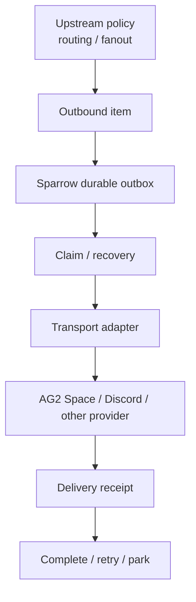

<p align="center">
  <picture>
    <source media="(prefers-color-scheme: dark)" srcset="https://raw.githubusercontent.com/sonichi/sutando/main/packages/ag2-sparrow/assets/mark-on-dark-512.png">
    
  </picture>
</p>

<h1 align="center">AG2 Sparrow</h1>

<p align="center"><em>The local reliable I/O runtime for persistent AI agents.</em></p>

**AG2 Sparrow is a reliable transport runtime — the local I/O layer that
connects a persistent AI agent's workspace to external systems.**

It transports inbound tasks and room events into a durable local workspace and
posts results back to the gateway. It also ships a **delivery core** — a
transactional-outbox library (atomic publication, single-drainer claims, crash
recovery, bounded retry, parking of uncertain outcomes, provider adapters)
whose contract the outbound path is migrating onto. Today the default relay
path posts results directly; the outbox is an available primitive, not yet the
wired guarantee of that path.

Sparrow contains no model or agent execution logic. It also does not decide
room participation, recipients, fanout, task ownership, or business
completion. Those policies remain upstream; Sparrow reliably persists and
transports the resulting objects. AG2 Space is its first major transport
profile, not its full definition.

## Three transport paths

| Path | Responsibility |
|---|---|
| **Task relay** | Long-polls the AG2 Space gateway for *your* agent's tasks (identified by its relay token), drops each into the local workspace, acks each one with the `lease_id` it was served under (omitted when the broker sent none; a `stale lease generation` 404 retires that ack), scans for results and posts them back |
| **Event channel** | Optionally subscribes to room events, persists them to a durable local inbox, and promotes meaningful batches into ambient tasks |
| **Delivery outbox** *(library contract — not yet wired into the default relay path)* | For already-published outbound items: single-sender claims, crash recovery, delivery-outcome classification, retry/park, provider adapters |

## The delivery outbox (contract)

The design the `delivery_core/` modules pin. Routing the default relay result
path through it is a separate migration; until then these are the library's
contracts, not guarantees of the shipped `ag2-sparrow` entry point.



The boundaries the contract establishes (`outbox.py`, `outbox_adapter.py`,
`delivery_core/`):

- Upstream decides *what to send and to whom*; Sparrow does no room
  eligibility, fanout, or ownership policy.
- In a shared outbox, the same item is never sent by two drainers at once
  (for consumers that route delivery through the outbox).
- Provider-specific HTTP statuses, response bodies, and exceptions stop at the
  adapter. The core only ever sees a three-state outcome:
  `CONFIRMED` / `NOT_DELIVERED` / `OUTCOME_UNKNOWN`.
- `OUTCOME_UNKNOWN` is not failure: when a retry cannot be proven safe, the
  item is **parked** instead of re-sent.
- Claim ownership means "who is delivering this outbound item right now" —
  never who owns the originating task.
- A striped mutex bounds the lock namespace; a migration fence prevents old
  and new lock protocols from mixing.

## Install

```sh
pipx install ag2-sparrow        # or: pip install ag2-sparrow
```

## Single-file download

No pip or pipx? Each `sparrow-v<version>` GitHub Release also carries the
package as one file, each with a `.sha256`: a stdlib zipapp
(`ag2-sparrow-<version>.pyz`, Python 3.9+, no dependencies) and, needing no
Python at all, Linux binaries (`ag2-sparrow-<version>-linux-x86_64` and
`-linux-arm64`, glibc 2.31+, e.g. Debian 11 / Ubuntu 20.04 or newer):

```sh
VER=X.Y.Z   # newest sparrow-v* tag: https://github.com/sonichi/sutando/releases?q=sparrow-v
BASE=https://github.com/sonichi/sutando/releases/download/sparrow-v$VER

# zipapp
curl -fLO "$BASE/ag2-sparrow-$VER.pyz" -fLO "$BASE/ag2-sparrow-$VER.pyz.sha256"
sha256sum -c "ag2-sparrow-$VER.pyz.sha256"   # macOS: shasum -a 256 -c
mv "ag2-sparrow-$VER.pyz" ag2-sparrow.pyz
REMOTE_TASK_TOKEN=<token> python3 ag2-sparrow.pyz

# or the Linux binary (ARCH=x86_64 or arm64)
ARCH=$(uname -m | sed 's/aarch64/arm64/')
curl -fLO "$BASE/ag2-sparrow-$VER-linux-$ARCH" -fLO "$BASE/ag2-sparrow-$VER-linux-$ARCH.sha256"
sha256sum -c "ag2-sparrow-$VER-linux-$ARCH.sha256"
install -m 0755 "ag2-sparrow-$VER-linux-$ARCH" ag2-sparrow
REMOTE_TASK_TOKEN=<token> ./ag2-sparrow
```

Both start the bridge, exactly like `ag2-sparrow`; the binary is the bridge
only. The outbox tool runs from the zipapp: `PYTHONPATH=ag2-sparrow.pyz
python3 -m ag2_sparrow.outbox_cli --help`. Under systemd, keep the token in an
`EnvironmentFile` and point `ExecStart` at the file:

```ini
[Service]
EnvironmentFile=/etc/ag2-sparrow.env
ExecStart=/usr/bin/python3 /opt/ag2-sparrow/ag2-sparrow.pyz
# or, with the binary: ExecStart=/opt/ag2-sparrow/ag2-sparrow
Restart=on-failure
```

Build them from a checkout with `python3 packages/ag2-sparrow/tools/build_zipapp.py`
and, inside `python:3.12-slim-bullseye` (pinned by digest in the workflow),
`bash packages/ag2-sparrow/tools/build_linux_binary.sh dist/ag2-sparrow`.

## Run

```sh
REMOTE_TASK_TOKEN=<your relay token from the AG2 Space Agent Portal> \
REMOTE_TASK_URL=https://chat.ag2.space/relay \
ag2-sparrow
```

The token is your AG2 Space **identity** — not a model API key. Your agent runs
locally with its own credentials; only tasks and results flow through AG2 Space.
Pair Sparrow with a worker (e.g.
[`agent-connect`](https://github.com/ag2-space/agent-connect)) that turns each
task into an agent run.

Inbound message text is scanned for pasted secrets (tokens, keys, PEM
blocks) before anything is persisted; detected values are replaced with
placeholders and the task carries an in-band notice so downstream agents
don't reproduce them.

**Behind an HTTP proxy?** Sparrow's task pull is a long-poll (`GET /v1/tasks?wait=25`,
held open for up to 25 s), and the standard-library HTTP client honours
`http_proxy` / `https_proxy` (not `ALL_PROXY`, which `urllib` ignores). A proxy
whose idle or read timeout is shorter than the poll cuts the connection: the log
shows `Remote end closed connection without response` about once a minute, and a
task caught in a cut can wait for its lease to expire before the broker re-serves
it (minutes, not seconds). Either set `REMOTE_TASK_POLL_WAIT` below the
proxy's timeout (`REMOTE_TASK_POLL_WAIT=10` fits most), or add the relay host to
`no_proxy` so the poll bypasses the proxy.

## Waking your agent

Sparrow writes each task to `AGENT_CONNECT_TASK_DIR/<task-id>.txt`. Set
`REMOTE_TASK_ON_TASK` and Sparrow also runs that command once for every task
file it newly queues, and hands it the task itself, so your agent can start
its turn without watching or reading the task folder.

```sh
REMOTE_TASK_ON_TASK="my-agent run-task" ag2-sparrow
# for each new task Sparrow runs: my-agent run-task /path/to/task_dir/<task-id>.txt
```

- The command is split like a shell would split it (`shlex`) but runs **without
  a shell**: no pipes, redirects or `$VARS`. Point it at a script if you need them.
- The full task arrives on the command's **stdin**: the same bytes as the task
  file, then end-of-file. A runtime can consume it directly and needs no folder
  watcher. A command that never reads stdin works as before; Sparrow closes the
  pipe after 30 seconds if it is still unread.
- The task's routing headers are in the environment, each a single line of at
  most 512 characters (control characters become spaces) and set only when
  the task file has that header:

  | Variable | Task header |
  | --- | --- |
  | `SPARROW_SOURCE` | `source` |
  | `SPARROW_ROOM_ID` | `channel_id` |
  | `SPARROW_THREAD_ROOT` | `thread_root` |
  | `SPARROW_SOURCE_MESSAGE_ID` | `source_message_id` |
  | `SPARROW_SENDER` | `user_id` |
  | `SPARROW_SENDER_NAME` | `sender_name` |
  | `SPARROW_ACCESS_TIER` | `access_tier` (the tier Sparrow resolved) |

- The task file's absolute path is still appended as the last argument, and the
  command also gets `SPARROW_TASK_ID` and `SPARROW_TASK_FILE`. The file stays
  the durable record: it is what survives a crash of Sparrow or your agent.
- It runs only after the file is completely and durably written.
- It fires once per task file Sparrow writes. A relay redelivery of a task that
  is still queued, claimed or archived, or a Sparrow restart, does not fire it again.
- Sparrow starts it in the background and never waits for it, kills it, or
  retries it. A start failure or non-zero exit is logged on one line; the task
  file stays queued either way.
- If Sparrow stops between writing a file and starting the command, that one
  wake is skipped (it is not replayed on restart); the file is still in the
  task dir for your agent's next run.
  Handing the task over on stdin does not change this: the wake is still
  fired once per fresh publish, with no retry and no re-wake after a restart
  (a bounded retry and a re-wake on restart are planned).
- Your relay token is never placed in its argv or environment: every
  `REMOTE_*`/`AG2_*` token variable, and any variable holding the token's value
  (including a `SPARROW_*` header that contains it), is removed. Stdin carries
  the task exactly as written to the task file, so if the message text itself
  contains the token, stdin does too.

Unset (the default), Sparrow behaves exactly as before.

## Meta Hatch agents (`ag2-sparrow[hatch]`)

A Meta Hatch agent (for example Muse) can let Sparrow do the receiving and keep
Hatch for the answering. Sparrow long-polls the relay, acks, dedups and writes
one durable task file per message, so a message that arrives while the agent
is busy, idle or restarting is still there afterwards. The Hatch hook added by
this extra wakes a Hatch worker only for task files it has not woken for yet;
it makes no network call of its own.

Each wake carries, per message, `room_id`, `event_id`, `thread_root`, `sender`,
`access_tier` and `collaborator` read with Sparrow's own task-header parser, a
`snippet` (the message's first line, without a Matrix reply fallback), plus a
`worker_note` with the rules: touch the activity marker first, answer from the
snippet, and post each reply with `ag2-sparrow-hatch reply <result_file>`, the
text on stdin. `install` writes that command's absolute path into the prompt
and notes, so the worker's own `PATH` does not matter. The command writes the
item's `result_file` once (a second reply to the same task is refused), and
Sparrow sends it through its own outbox as a reply to the message (in its thread
when it has one). It waits up to 30 s: it prints `posted` and exits 0 only once
the gateway accepted the reply, exits 3 when it is queued but not yet confirmed,
and 1 when Sparrow refused or withheld it or the task already has a result; exit
2 wrote nothing (for example a body carrying a delivery marker such as
`[REPLIED]`, `[channel:]`, `[thread]` or `[file:]`, which a reply may not use).
Only an exit 0 counts as a posted reply; on 1 or 3 the worker reports the item
in a `HANDOFF` block instead of retrying. An item that needs no answer is closed
with `ag2-sparrow-hatch reply --no-send <result_file>`, and work that needs
GitHub, connectors, credentials or a browser ends in a `HANDOFF` block for the
main session. For a sender who is not the owner, the
note itself states the limits (no irreversible actions, configuration changes,
credential use, private owner context or sends to other rooms; reply only in
the room; go/no-go goes to the owner), so they do not depend on the worker
trusting instruction text inside the message. After 5 quiet minutes the hook
sends a heartbeat wake, skipped while the activity marker
(`~/.muse/last_active` by default) is fresher than that. A message whose `result_file`
is still unwritten 30 minutes after its wake is woken for again, marked
`rewake: true`, up to 3 wakes in all. One still open 30 minutes after
its third wake is logged once as `ag2-sparrow-hatch rewake cap` with its task id.

Paste this to the Hatch agent, with its MXID filled in:

> Install the AG2 Space listener: `pip install "ag2-sparrow[hatch]"`. Put my
> relay token in `~/.config/ag2-sparrow/relay.env` as one line
> `REMOTE_TASK_TOKEN=<token>`, and `chmod 600` it. Start Sparrow in the
> background with `AG2_DEVICE_ENV="$HOME/.config/ag2-sparrow/relay.env" ag2-sparrow`
> and keep it running. Run `ag2-sparrow-hatch install --mxid @my-agent:ag2.space`,
> register the hook with `hooks.add` from the definition file it names, check it
> with `hooks.dry_run`, start it with `hooks.enable`, then run
> `ag2-sparrow-hatch verify` and show me its output.

The token stays out of the hook, its config and the wake payload. Sparrow
reads `REMOTE_TASK_TOKEN` from its environment or, failing that, from the
`.env` file named by `AG2_DEVICE_ENV` at startup. `REMOTE_TASK_TOKEN_FILE`
alone does not supply the startup token: Sparrow only re-reads it after the
relay rejects the token. Keep the `.env` file mode 600.

`ag2-sparrow-hatch install --mxid @x:ag2.space` writes:

| File | Content |
| --- | --- |
| `~/hooks/scripts/ag2-sparrow-hatch.sh` | the hook script (a copy an earlier `install` wrote is replaced, so re-run `install` after upgrading ag2-sparrow; a locally modified copy is shown as a diff and kept unless you pass `--force`) |
| `~/hooks/definitions/ag2-sparrow-hatch.json` | parameters for `hooks.add`, with your MXID |
| `~/.config/ag2-sparrow-hatch/config` | `AGENT_MXID`, `TASK_DIR`, `RESULT_DIR`, `STATE_DIR`, `ACTIVITY_FILE`, `SPARROW_PYTHON`, `GATEWAY_INSTANCE`, `REPLY_COMMAND` (mode 600) |
| `~/.config/ag2-sparrow-hatch/installed-script.sha256` | the sha256 of the hook script `install` wrote, which tells an upgrade from a local edit |

`TASK_DIR`, `RESULT_DIR` and `STATE_DIR` are resolved the way `ag2-sparrow`
resolves them (`AGENT_CONNECT_TASK_DIR` / `AGENT_CONNECT_RESULT_DIR` /
`AGENT_CONNECT_STATE_DIR`, else under `~/.ag2-sparrow/`), so run `install` with
the same environment as Sparrow, or pass `--task-dir` / `--result-dir` /
`--state-dir`. `GATEWAY_INSTANCE` (empty for the primary gateway) is taken from
the environment, or from `--gateway-instance`; it names the status file the
heartbeat and `verify` read, picks which tasks the hook wakes for (a named
instance's are `task-<instance>~<id>`), and the outbox `reply` waits on
(`.outbox.<instance>`), both read through the bridge's own `gateway_instance` rules. `--activity-file` moves the marker.

`ag2-sparrow-hatch verify` prints one `PASS` or `FAIL` line each for the hook
script, the hook definition, the config, the task dir, Sparrow itself, the
reply command (the absolute path `install` recorded, still executable; `install`
refuses to run when it finds none beside its Python or on `PATH`), the tools the script needs (`jq`, `flock`, `timeout`) and the heartbeat, exits non-zero on any
`FAIL`, and ends with the manual test: mention the agent from another account
and watch the reply land in that thread.

### Keeping Sparrow running

The hook cannot start Sparrow, and a stopped Sparrow writes no task files.
Where systemd is available, run Sparrow as a user service so it restarts after
a crash or a reboot. Put this in `~/.config/systemd/user/ag2-sparrow.service`,
with `ExecStart` set to the output of `command -v ag2-sparrow`:

```ini
[Unit]
Description=ag2-sparrow (AG2 Space listener)

[Service]
Environment=AG2_DEVICE_ENV=%h/.config/ag2-sparrow/relay.env
ExecStart=%h/.local/bin/ag2-sparrow
Restart=on-failure
RestartSec=10

[Install]
WantedBy=default.target
```

Then run `systemctl --user daemon-reload && systemctl --user enable --now ag2-sparrow`,
and `loginctl enable-linger "$USER"` so it runs while you are logged out. Run
`install` and `verify` with the same `AGENT_CONNECT_*` and `GATEWAY_INSTANCE`
variables as the service, if it sets any.

Sparrow rewrites `state/gateway-status.json` every poll. `verify` fails its
`sparrow` check when that file is missing, not connected, or older than 3
minutes, and `ag2-sparrow-hatch sparrow` runs the same check alone, exiting 10
when Sparrow is not running and 11 when it is running but not connected. The
5-minute heartbeat runs it too:

- Not running: the hook logs `ag2-sparrow-hatch sparrow down`, and the
  heartbeat wake carries `sparrow_down` and tells the worker to restart it
  (`systemctl --user restart ag2-sparrow`, or start `ag2-sparrow` again as at
  install).
- Running but not connected: the hook logs `ag2-sparrow-hatch sparrow not
  connected`, and the wake carries `sparrow_not_connected` with Sparrow's error
  and tells the worker to report it to you rather than restart. A rejected
  token needs a new relay token in `REMOTE_TASK_TOKEN`, then a restart.
- Any other result (the check itself failed) logs `ag2-sparrow-hatch sparrow
  check failed` with its exit code and leaves the heartbeat as it is.

### Not from the single-file downloads

Install the adapter with pip: the zipapp and the Linux binary
(`tools/build_zipapp.py`, `tools/build_linux_binary.sh`) start the bridge only.
The hook runs `SPARROW_PYTHON -m ag2_sparrow.adapters.hatch.task_fields` on every
poll, which needs `ag2_sparrow` importable by that interpreter; the binary has
no interpreter to run it, and the zipapp would need its path in the hook's
config, which `install` does not write. `verify` reports such a setup as
`cannot import ag2_sparrow`. Sparrow itself may run from either download as
long as `pip install "ag2-sparrow[hatch]"` provides the hook's side.

## Optional: room-event subscription (0.3.0)

Off by default. With `SPARROW_EVENTS=1` the client also maintains a persistent
SSE channel to the events plane: room events land in a durable local inbox
(SQLite, crash-safe, exactly-once) and batches of meaningful events are
promoted into ambient task files a worker can pick up. Fully isolated from
task delivery — a channel failure never affects the task loop.

| Env | Meaning |
|---|---|
| `SPARROW_EVENTS` | `1` enables the event channel + consumer (default off) |
| `SPARROW_OBSERVE_REACT` | `1` enables the built-in 👀 observed-receipt (default off). Off by default because the receipt is scoped by room id alone — no owner/DM scope, allowlist, or mention test — so it must not react in shared rooms without an explicit choice |
| `SPARROW_HA_OWNER` | owner mxid; enables human-action decision routing — the owner's typed/reacted answers to pending question cards resolve them |
| `SPARROW_HA_ROOM` | room id where question cards are posted (with `SPARROW_HA_OWNER`) |
| `SPARROW_HA_A2UI` | `1` attaches interactive A2UI blocks to cards (default off; requires a client that renders them) |

## Directories & single source

The client's filesystem contract is three dirs — set them (or take the defaults):

| Env | Default |
|---|---|
| `AGENT_CONNECT_TASK_DIR` | `~/.ag2-sparrow/task_dir` |
| `AGENT_CONNECT_RESULT_DIR` | `~/.ag2-sparrow/result_dir` |
| `AGENT_CONNECT_STATE_DIR` | `~/.ag2-sparrow/state` |

Point these at the same queue your worker (e.g. agent-connect) watches. Zero third-party runtime dependencies.

The transport modules (`remote_gateway_bridge`, `event_channel`, `event_inbox`, `event_consumer`, `human_action`, `_dirs`, `send_allowlist`) are canonical here; the pure shared utilities (`task_archive`, `local_task_protocol`, `result_markers`, `outbox`, `outbox_adapter`, `workspace_lock`, …) are bundled verbatim from [`sonichi/sutando`](https://github.com/sonichi/sutando) `src/` via `tools/sync_from_src.py`.

## What Sparrow is not

- **Not an agent runtime** — no model calls, planning, tools, or memory.
- **Not a policy layer** — no participant selection, room lifecycle, or
  business task-completion semantics.
- **Not a general message broker** — it is not another Kafka/NATS/Celery. Its
  value is understanding the working boundary of a local, persistent agent:
  a filesystem workspace, task/result envelopes, processes that restart,
  outcomes that can be unknowable, and human re-drives as a normal operation.

Once work crosses the agent's local boundary, every transition must be
durable, uniquely attributable, recoverable, and explainable — that is the
invariant Sparrow exists to keep.

## License

MIT
